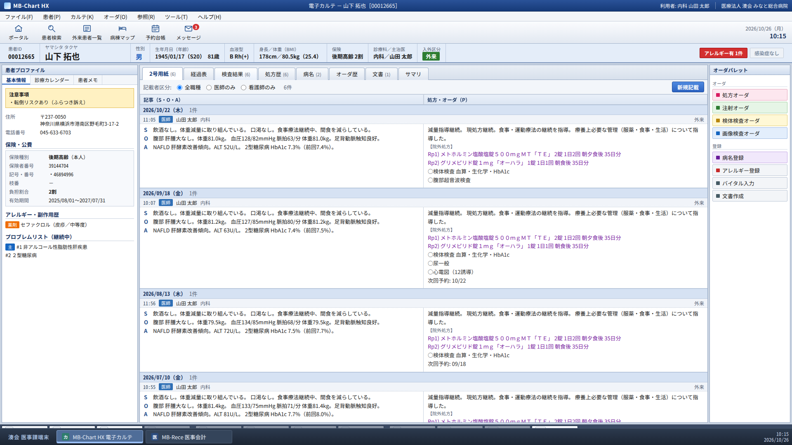
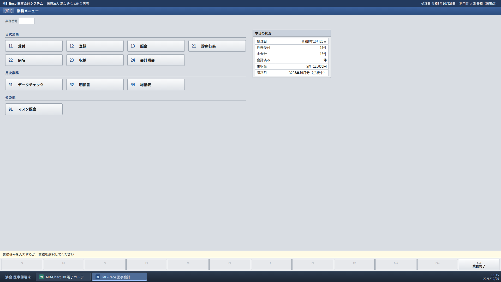
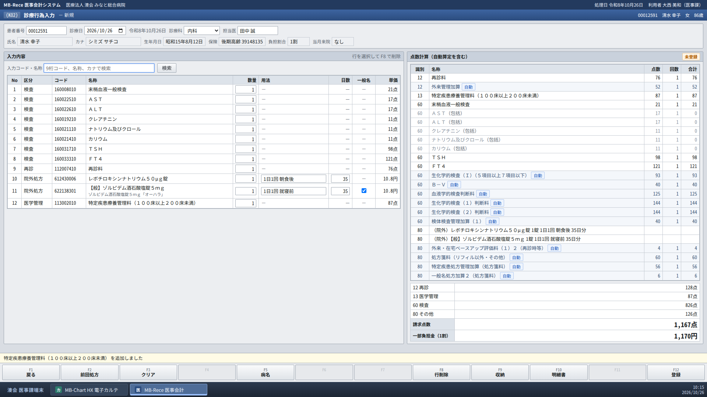
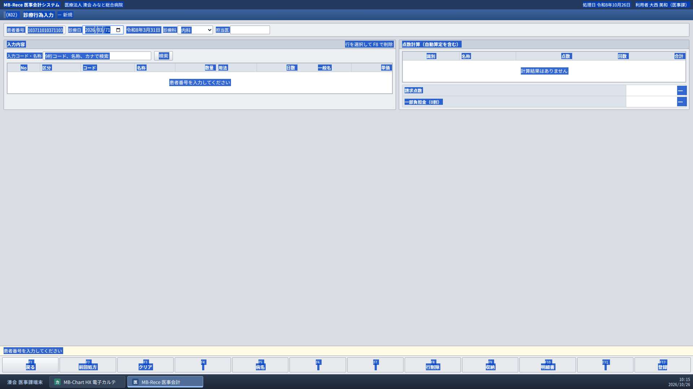

# 画面操作AIは電子カルテとレセコンを使いこなせるか — Claude Opus 5.5が医事業務で正答率96%、レセプト点検は全問正解

> [6月の記事](https://genshi.ai/articles/vlm-emr-vendor-lockin)では、画面操作AIで電子カルテのボタンを押せるかを測りました。今回はその先へ進み、医事課の端末を再現して、**電子カルテを見ながらレセコンを操作する**という、病院で毎日人の手で行われている業務をAIに任せてみました。結果、**Claude Opus 5.5は画面だけを頼りにレセコンを操作し、医事業務23タスクを正答率96%でこなしました。カルテと突き合わせてレセプトの誤りを直す点検は、9件すべて正解です。**「一方のシステムを読み、もう一方に正しく入れ、突き合わせて確かめる」というこの作業は、**電子カルテの移行作業とまったく同じ形**をしています。

## TL;DR

- **Claude Opus 5.5は、電子カルテとレセコンを画面だけで操作し、医事業務23タスクで正答率96%（22件正解）でした。** 照会・入力・点検はすべて正解で、唯一の誤りは転記1件の2点差（716点と718点）です
- **レセコンも操作できました。** 受付、病名の転帰入力、入金、住所変更から、検査を中心とする20項目と院外処方4剤を含む診療行為入力まで、ORCA風のレセコンを人と同じ画面・同じキー操作で使いこなしています
- **レセプト点検は9件すべて正解（満点）。** 算定漏れ、処方日数の転記誤り、オーダのない検査、外来管理加算の誤算定をカルテと突き合わせて見つけて直し、誤りのない対照には「誤りなし」と答えて何も変えませんでした
- 計測台は、医事課の端末を再現した架空の電子カルテ（MB-Chart HX）とレセコン（MB-Rece）です。点数計算には、厚生労働省と社会保険診療報酬支払基金が公開している令和8年度改定の**公式マスター一式**を使っています
- 院内で動かせるローカルモデルは、最良のQwen3.8-27Bでも正答率22%でした。2つのシステムをまたぐ転記・点検に限ると、3モデル合わせた成功率はわずか5%（42回中2回）で、誤った内容なのに「完了」と報告する例もありました
- 「一方のシステムを読み、もう一方に正しく入れ、突き合わせて確かめる」というこの作業は、**電子カルテの移行作業と同じ形**をしています。Claudeの結果は、旧ベンダーがデータを出してくれなくても、画面さえ見えれば移行を進められる時代が近いことを示しています

全モデル・全タスクの録画は、[ベンチマークビューア](https://pphouse.github.io/medbridge-rece-viewer/)でAIの思考と一緒に見られます。成功したタスクも失敗したタスクも、すべて公開しています。

## なぜ医事課の転記なのか

電子カルテとレセコン（医事会計システム）のベンダーが別々で、連携がない、あっても一部だけ、という病院は珍しくありません。その隙間を埋めているのが医事課の人手です。

- 診察が終わった患者のカルテを開き、処方・検査・指導料の根拠を読み取って、レセコンに入力する（転記）
- 月末には、レセコンのデータチェックで出たエラーをカルテと突き合わせて直す（点検）
- 直す対象は、病名漏れ、特定疾患療養管理料の算定漏れ、処方日数の転記ミス、オーダのない検査の入力、外来管理加算の誤算定など

どれも「ある画面を見て、別の画面に打ち込む」仕事です。システム間の連携を待たずに画面操作AIで埋められれば、医事課の負担は大きく減ります。逆に、AIが「完了しました」と言いながら誤った請求データを作れば、返戻や査定、場合によっては不正請求の問題につながります。

### この作業は電子カルテの移行と同じ形をしている

電子カルテは一般に5〜7年ごとに更新されます。そのたびに病院を悩ませるのがデータ移行です。

- 旧ベンダーが出してくれるデータは、SS-MIX2などの標準形式に載る範囲（処方・検査結果・病名など）に限られることが多く、カルテ記事、テンプレート、文書、細かな設定は残りがちです
- 出してもらえる範囲を広げようとすると、追加の費用や時間がかかります
- 結局、継続中の処方や病名、アレルギー、予約などを、稼働前に職員が旧システムの画面を見ながら新システムへ手で入力し、さらに目で突き合わせて確認する、という作業が発生します

この「旧システムの画面を読む → 新システムに入力する → 両者を突き合わせて確かめる」という流れは、今回のベンチの**転記と点検そのもの**です。電子カルテからレセコンへの転記ができるAIは、旧電子カルテから新電子カルテへの転記もできます。今回の計測は、医事業務の自動化であると同時に、**電子カルテ移行の自動化がどこまで現実的か**を測る試験でもあります。

## 計測台：医事課の端末を作った

▲ 電子カルテ（MB-Chart HX）。画面下のタスクバー「MB-Chart HX 電子カルテ」「MB-Rece 医事会計」でレセコンと切り替えます。この患者は10/22に腹部超音波検査を受けています。

▲ レセコン（MB-Rece）の業務メニュー。ORCAにならい、画面ID（M01）、業務番号による画面遷移、ファンクションキー（F1 戻る、F12 登録）を備えています。

▲ 診療行為入力（K02）。左が入力した項目、右が自動算定を含む点数計算です。生化学的検査(I)のまるめ、判断料、外来管理加算、処方箋料、特定疾患処方管理加算、一般名処方加算は「自動」で計上されます。

### マスターは公式のものをすべて使う

点数計算に使うデータは、すべて公式サイトから取得しています。

- 支払基金の**基本マスター**（令和8年度改定）：医科診療行為、医薬品、特定器材、コメント、傷病名、修飾語
- 厚生労働省の**医科電子点数表**：包括、背反（同日・同月・同一・週単位）、算定回数の上限、入院基本料、補助マスター
- 厚生労働省の**一般名処方マスタ**（一般名処方加算の判定に使用）
- レセプト電算処理システムの記録条件仕様

架空の病院は、一般病床180床・出来高算定・院外処方という設定です。再診料、外来管理加算、特定疾患療養管理料（100床以上200床未満）、生活習慣病管理料(II)、処方箋料、特定疾患処方管理加算、一般名処方加算、生化学的検査(I)のまるめ、検体検査判断料、薬剤料の端数処理（五捨五超入）、一部負担金の10円未満の四捨五入までを実装しました。データチェックでは、適応病名なし、主病なし、算定回数の超過、背反、急性疾患の転帰漏れ、長期間放置された疑い病名などを検出します。

### データは電子カルテから作る

患者150名（入院12名、慢性疾患の外来118名、急性疾患20名）のカルテを、病名コード・医薬品コード・診療行為コード付きで生成し、**そこからレセコンの入力済みデータを作っています**。8月・9月分は請求済み、10月分は点検中、本日（10/26）は会計待ちの患者が並んでいる、という月末の医事課を想定しています。

そこへ、現場でよくある誤りを17件仕込みました。病名漏れ、特定疾患療養管理料や生活習慣病管理料の算定漏れ、心電図の入力漏れ、処方日数の転記誤り、オーダのないHbA1cの入力、腹部エコーと同日の外来管理加算、主病の誤り、急性疾患の転帰漏れなどです。

「高橋 和子」と「髙橋 和子」、同姓同名の「佐藤 美咲」2名、「斎藤／齋藤」「渡辺／渡邊」など、患者取り違えの種も仕込んでいます。

### タスク

| 区分 | 数 | 例 | 判定方法 |
|---|---|---|---|
| 照会 | 5 | 保険者番号と負担割合、髙橋 和子さんの患者番号、ある日の請求点数と一部負担金、データチェックでエラーが出た患者、明細書の合計点数と実日数 | 回答の値が正解と一致するか |
| 入力 | 4 | 外来受付、病名の転帰入力、未収金の入金、転居に伴う住所変更 | レセコンの状態が期待どおりに変わり、それ以外は変わっていないか |
| 転記 | 5 | 本日診察を終えた患者のカルテを見て、診療行為入力で本日分を登録（処方3剤だけの患者から、検査を中心とする20項目＋院外処方4剤の患者まで） | 登録した項目・数量・用法・日数と点数が正解と一致するか |
| 点検 | 9 | 「この日の診療行為をカルテと突き合わせて点検し、誤りがあれば修正する」。8件は誤りを仕込んだもの、1件は誤りのない対照 | 修正後の点数と項目が正解と一致するか。対照では「誤りなし」と答え、何も変更していないか |

AIに渡すのは**画面のスクリーンショットだけ**です。できる操作はクリック、文字入力、キー入力、スクロールのみ。ステップ数の上限は照会・入力が40、転記・点検が100で、同じ操作を6回続けた時点で打ち切ります。すべての実行を録画しており、ビューアで1ステップずつ確認できます。

## 比較したモデル

| モデル | 種別 | 実行環境 |
|---|---|---|
| Qwen3.8-27B | 汎用VLM（Dense） | ローカル（Q8_0） |
| Holo4-27B | GUI操作特化（Qwen3.8-27Bベース、Dense） | ローカル（Q8_0） |
| Holo4-35B-A3B | GUI操作特化（MoE、アクティブ3B） | ローカル（Q8_0） |
| Claude Opus 5.5 | 汎用（クラウドAPI） | 参考値 |

ローカルモデルは、NVIDIA DGX Spark 1台上のllama.cppで動かしました。院内ネットワークに置ける構成です。Claudeはクラウドのため患者データを院外に出すことになり、**実運用の選択肢というより「現在の技術でどこまでできるか」を示す参考値**です。

## 結果

| | 正答率 | 照会 | 入力 | 転記 | 点検 | 1ステップの時間（中央値） | 成功タスクの所要時間（中央値） |
|---|---|---|---|---|---|---|---|
| Claude Opus 5.5 | **96%**（22/23） | 5/5 | 4/4 | 4/5 | 9/9 | 2.7秒 | 60秒 |
| Qwen3.8-27B | 22%（5/23） | 3/5 | 2/4 | 0/5 | 0/9 | 17.2秒 | 120秒 |
| Holo4-27B | 17%（4/23） | 2/5 | 1/4 | 0/5 | 1/9 | 17.0秒 | 192秒 |
| Holo4-35B-A3B | 13%（3/23） | 1/5 | 1/4 | 0/5 | 1/9 | 4.3秒 | 63秒 |

**Claudeは医事課の仕事をほぼ完璧にこなしました。** 照会5件・入力4件・点検9件はすべて正解です。 検査を中心とする20項目と院外処方4剤の転記も、点数まで正解と一致しています。点検では、特定疾患療養管理料の算定漏れ（カルテの「療養上必要な管理について指導した」という記載が根拠）や、腹部超音波検査と同じ日に手入力された外来管理加算を見つけて修正しました。誤りのない対照には「誤りなし」と答え、何も変更していません。

<!--VIDEO:claude-t05-->

<!--VIDEO:claude-c08-->

唯一の失敗（転記T03）は、院外処方の5剤を入力する代わりに、処方箋料と一般名処方加算を自分で手入力したことによるものです。その結果、一般名処方加算の区分を誤りました（716点、正解は718点）。「処方を入力すれば加算は自動で付く」というレセコンの作法を知らない、医事の新人がやりがちな誤りです。

**ローカルモデルは、1つの画面で完結する照会や入力ならある程度こなせます。一方、電子カルテとレセコンを行き来する転記・点検の成功率は、3モデル合わせてわずか5%（42回中2回）でした**（2回とも主病の修正）。別途行った電子カルテ単体の通し業務の計測（25タスク）では正答率68%だったQwen3.8-27Bも、転記・点検では0%（14件中0件）です。

## 失敗から見えたこと

### ① 入力欄の中身を消してから入力できない

▲ Qwen3.8-27Bが点検の対照タスク（C09）で行き詰まった画面。患者番号欄は「1037111010371103」、診療日は「2026/03/71」になっています。青い網掛けは、ページ全体に対してCtrl+Aを押した結果です。

<!--VIDEO:qwen38-c09-->

患者番号欄をクリックして「10371」と打つと、元の値の後ろに付け足されてしまいます。Qwen3.8-27Bは「患者番号欄に1037111010371103と表示されているが、これは10371の患者番号ではない」と、異常には正しく気づいていました。それでも、欄の中ではなくページ全体を選択するCtrl+Aを押し続け、同じ操作の繰り返しで打ち切られました。

日付欄はさらに手ごわく、Claudeでさえ点検タスクで日付を10/22に合わせるのに約20ステップかかっています（思考の中で「レセコンの日付欄は扱いにくい」と書いていました）。年・月・日が区切られた日付入力は、人間には便利でも、画面だけを頼りに操作するAIにとっては難所です。Holo4-35B-A3Bは「10月2日の診療行為を確認する必要がある」と書きながら、日付欄のダブルクリックを繰り返して打ち切られました。

ローカル3モデルの計69回の実行のうち35回が、同じ操作の繰り返しで打ち切られています（Holo4-35B-A3Bが15回、Holo4-27Bが13回、Qwen3.8-27Bが7回）。

### ② 2つの画面の情報を覚えておけない

転記は「カルテを読む → レセコンに切り替える → 読んだ内容を入力する」の繰り返しです。今回のローカルモデルの構成では、各ステップで見えるのは最新の画面1枚と、これまでの操作履歴（テキスト）だけです。そのため、レセコンに切り替えた時点でカルテの内容が見えなくなります。

- Qwen3.8-27Bは、検査10項目をまるごと入れ忘れたうえ、院外処方も5剤中3剤が抜けるか一般名指定を誤ったまま登録しました（200点、正解は718点）
- Holo4-27Bは、処方3剤の患者に初診料だけを入力して登録しました（308点、正解は376点）

Claudeは会話履歴に過去の画面が残るため、カルテで見た検査を順番に入力できます。この差は、モデルの賢さだけでなく**エージェントの記憶の仕組み**の差でもあります。ローカルモデルで転記をさせるなら、カルテから読み取った内容をいったん構造化データとして書き出させ、それを見ながら入力させるといった設計が必要です。

### ③ 点検は「誤りを探す」前に止まる

点検タスクの失敗では、ほぼすべてレセコンの記録が最初の状態のまま残っていました。誤りを見落としたのではなく、目的の患者・目的の日付をカルテとレセコンの両方で開く段階までたどり着けていません。誤りのない対照（C09）でも、「誤りなし」と答えられたローカルモデルはありませんでした。

### ④ 「完了」の報告を信じてはいけない

| モデル | タスク | 実際に起きたこと |
|---|---|---|
| Qwen3.8-27B | 病名「急性膀胱炎」を転帰「治癒」、転帰日10/15で登録 | 転帰日が**「202610-12-15」**という崩れた値で登録されたのに「完了」と報告 |
| Qwen3.8-27B | 住所と郵便番号を変更 | 住所は変えたが**郵便番号は旧住所のまま**なのに「完了」と報告 |
| Qwen3.8-27B | 本日分を転記 | **検査10項目と処方の一部が抜けたまま**登録して「完了」と報告 |
| Holo4-27B | 本日分を転記 | **処方3剤が抜けたまま**登録して「完了」と報告 |
| Holo4-27B | 不足している病名を登録 | **何も登録せずに**「完了」と報告 |
| Holo4-35B-A3B | 本日分を転記 | 100ステップを使い切り、**何も登録せずに**「完了」と報告 |
| Holo4-27B | オーダのないHbA1cを削除 | HbA1cを残したまま**再登録** |

転帰日の件は、崩れた日付をそのまま受け付けてしまった計測台（レセコン）側の甘さでもあります。実際のレセコンは入力時に日付の妥当性をチェックしますが、**AIが画面に何を打ち込むかは予測できない**ため、入力チェックは人間相手のとき以上に重要になります。

電子カルテ単体の計測では「Qwen3.8-27Bは失敗しても何も書き込まずに止まる」という長所が見られましたが、今回は当てはまりませんでした。業務が複雑になるほど、「途中までは正しい」誤った書き込みが増えます。

## 電子カルテ移行の自動化に向けて

今回の結果を電子カルテの移行作業に当てはめると、次のことが言えます。

**1. 技術的には、すでに可能な水準に来ている。**
Claudeは、カルテを読んで別システムに入力する転記を5件中4件、カルテと別システムの記録を突き合わせる点検を9件すべて正しくこなしました。旧ベンダーからデータを出してもらえない項目でも、**画面に表示できるものはAIが読み取って新システムに移せる**、ということです。これは[6月の記事](https://genshi.ai/articles/vlm-emr-vendor-lockin)で書いた「ベンダーロックインを画面操作AIで回避する」という考え方の、もっとも具体的な使い道です。

**2. 移行は、医事業務より画面操作AIに向いている。**
- **旧システムは読むだけでよい。** 誤った書き込みのリスクは新システム側に限られ、しかも稼働前のデータなので、本番の請求や診療に影響が出る前に検証できます
- **リアルタイム性が要らない。** 1ステップ17秒のローカルモデルでも、夜間や休日にまとめて流せば時間は問題になりにくい作業です
- **正解の照合がしやすい。** 移行元の画面という「正解」が常にあるので、今回のベンチと同じように、移行後の状態を機械的に突き合わせて検証できます

**3. ただし、今のローカルモデルにそのまま任せるのは早い。**
院外にデータを出せない以上、移行作業は院内のローカルモデルで行うことになります。そのローカルモデルが転記・点検でほぼ全滅し、誤った「完了」報告まで出している現状では、次の設計が欠かせません。
- **「読む」と「書く」を分ける。** 旧システムの画面からは構造化データ（JSONやCSV）を書き出させるところまでをAIに任せ、新システムへの投入は、可能ならインポート機能で行う
- **全件を機械的に照合する。** AIの「完了」報告ではなく、移行後の件数・コード・日付を移行元と突き合わせて確かめる
- **人が最終確認する。** 照合で差分が出たものだけを人が見る

6月の記事の時点では、MoEモデルは画面1枚の操作すらまともにできませんでした。それが別途の計測では、GUI操作の追加学習を受けたMoEモデルが、画面1枚の指示なら約9割を正解するところまで来ています。2つのシステムをまたぐ作業にローカルモデルが追いつくのも、そう遠くないと考えています。電子カルテの次の更新までに、移行作業の大部分を画面操作AIで進められる可能性は十分にあります。

## 病院の医事課・情報システム部門の方へ

1. **医事業務のAI化は「照会」と「1画面で完結する入力」から始める。** 2つのシステムをまたぐ転記・点検は、現時点のオンプレのモデルには任せられません
2. **AIの「完了」報告で終わりにしない。** 登録後の状態（点数、項目数、データチェックの結果）を、AIとは別の仕組みで機械的に検証してください。今回のベンチの判定方法が、そのまま検証の雛形になります
3. **転記は「読む」と「打つ」を分ける。** カルテからの読み取りは構造化データとして出力させ、人が確認してから入力する、あるいはインポート機能を使う。画面操作に頼るのは、ほかに連携手段がない部分だけにします
4. **ベンダーにUIの改善を要望する。** 入力欄を選んだら中身を全選択する、日付を8桁の数字でも入力できるようにする、不正な値は登録前にはじく。人にもAIにも効く改善です
5. **次の電子カルテ更新に向けて、移行作業での活用を検討しておく。** 旧システムを読むだけで済み、夜間に流せて、全件を照合できる移行作業は、画面操作AIのもっとも現実的な使い道の1つです。今のうちに小さな範囲で試しておくことをおすすめします

## 付録

- [ベンチマークビューア](https://pphouse.github.io/medbridge-rece-viewer/)：全モデル・全タスクの録画を、各ステップの画面とAIの思考つきで再生できます（早送り、シーク、思考の字幕表示に対応）
- 推論環境：llama.cpp `llama-server`（Q8_0、思考モード無効、JSON Schemaによる出力制約）、NVIDIA DGX Spark 1台
- 6月の記事で最良だったQwen3.6-27Bは、後継のQwen3.8-27Bが転記・点検で全滅した時点で計測を打ち切りました

計測台もデータもすべて架空のもので、実在の患者・医療機関・製品とは関係ありません。点数計算は計測用の実装であり、実際の請求に使える精度は保証しません。
